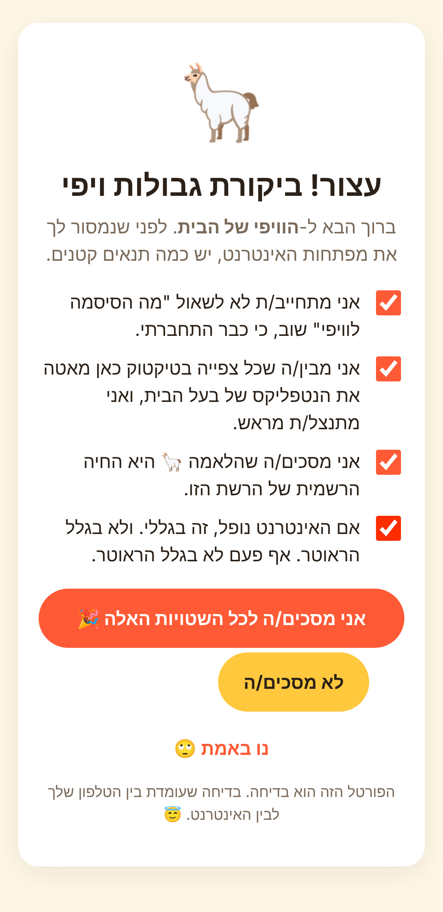

# עמוד נחיתה מצחיק לוויפי (Captive Portal)

כל מכשיר חדש שמתחבר לרשת האורחים מקבל עמוד "ביקורת גבולות ויפי" עם תנאי שימוש מגוחכים.
כפתור "לא מסכים/ה" בורח מהאצבע, ורק אחרי סימון כל הריבועים אפשר לאשר ולקבל אינטרנט (ל-24 שעות).



## למה צריך מכשיר נוסף?

ראוטרי **TP-Link Deco** לא מאפשרים להריץ עמוד נחיתה משלך: אי אפשר להתקין עליהם תוכנה,
ורשת האורחים שלהם לא תומכת בעמוד מותאם אישית. לכן עמוד הנחיתה ירוץ על ראוטר קטן נוסף עם OpenWrt,
שמחובר בכבל ל-Deco ומשדר רשת אורחים נפרדת:

```
אינטרנט ── Deco (הרשת הרגילה שלך, בלי שינוי)
              │ כבל רשת
              └── ראוטר GL.iNet / OpenWrt ── רשת "אורחים" עם עמוד הנחיתה
```

**ראוטר מומלץ:** כל דגם של GL.iNet (למשל Opal GL-SFT1200 או Beryl AX GL-MT3000). הם מגיעים עם OpenWrt
מותקן, עולים בערך 100–300 ₪ ומתחברים בכבל לאחת היציאות הפנויות ב-Deco.

## התקנה

1. חבר/י את ה-GL.iNet בכבל מיציאת ה-WAN שלו ליציאה פנויה ב-Deco.
2. היכנס/י לממשק שלו (`http://192.168.8.1`), הגדר/י סיסמת ניהול, ותן/י לרשת ה-WiFi שלו שם כמו `Guests`.
   מומלץ להשאיר את הרשת **פתוחה בלי סיסמה**, כי עמוד הנחיתה הוא ה"שומר".
3. הפעל/י SSH (ב-GL.iNet זה פעיל כברירת מחדל), והעתק/י את התיקייה:
   ```sh
   scp -O -r captive-portal root@192.168.8.1:/tmp/
   ssh root@192.168.8.1
   sh /tmp/captive-portal/install.sh "הוויפי של משפחת כהן"
   ```
4. התחבר/י לרשת `Guests` מטלפון. העמוד אמור לקפוץ לבד.

אפשר לכבות את רשת האורחים המובנית של ה-Deco באפליקציה כדי שהאורחים יכירו רק את הרשת החדשה.

## שינוי הבדיחות

כל הטקסטים נמצאים ב-`theme_funny_he.sh`, בפונקציה `continue_form` (עמוד האישור) וב-`landing_page` (עמוד ההצלחה).
אחרי עריכה מעתיקים שוב ל-`/usr/lib/opennds/` ומריצים `/etc/init.d/opennds restart`.

כדי לראות את העמוד בדפדפן בלי ראוטר: `./make-preview.sh` ופותחים את `preview.html`.

> שימו לב: אין להשתמש בתו `$` בתוך ה-HTML/JS של ה-Theme, כי הוא קובץ shell.

## הגדרות שימושיות

- **משך החיבור:** `sessiontimeout` בתחתית ה-Theme (בדקות; ברירת המחדל כאן 1440, כלומר 24 שעות).
- **מכשירים שלא יקבלו את העמוד** (טלוויזיה, מצלמות):
  `uci add_list opennds.setup.trustedmac='aa:bb:cc:dd:ee:ff' && uci commit opennds && /etc/init.d/opennds restart`
- **כיבוי:** `/etc/init.d/opennds stop && /etc/init.d/opennds disable`
